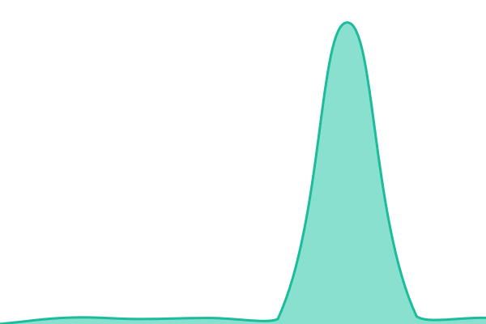
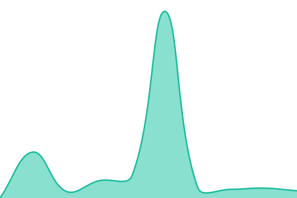
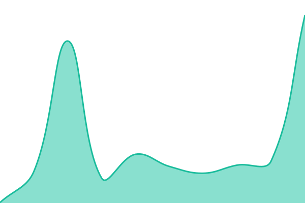
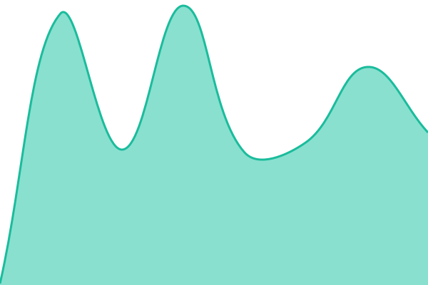
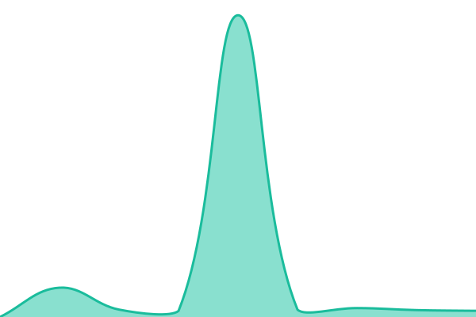

# [📈 Live Status](https://status.adsb.lol): <!--live status--> **🟩 All systems operational**

This repository contains the open-source uptime monitor and status page for [ADSB.lol](https://adsb.lol), powered by [Upptime](https://github.com/upptime/upptime).

With [Upptime](https://upptime.js.org), you can get your own unlimited and free uptime monitor and status page, powered entirely by a GitHub repository. We use [Issues](https://github.com/adsblol/status/issues) as incident reports, [Actions](https://github.com/adsblol/status/actions) as uptime monitors, and [Pages](https://status.adsb.lol) for the status page.

<!--start: status pages-->
<!-- This summary is generated by Upptime (https://github.com/upptime/upptime) -->
<!-- Do not edit this manually, your changes will be overwritten -->
<!-- prettier-ignore -->
| URL | Status | History | Response Time | Uptime |
| --- | ------ | ------- | ------------- | ------ |
|  [adsb.lol](https://adsb.lol) | 🟩 Up | [adsb-lol.yml](https://github.com/adsblol/status/commits/HEAD/history/adsb-lol.yml) | 

 441ms
     
 | 

<a href="https://status.adsb.lol/history/adsb-lol">100.00%</a>
    

|  [www.adsb.lol](https://www.adsb.lol/readyz) | 🟩 Up | [www-adsb-lol.yml](https://github.com/adsblol/status/commits/HEAD/history/www-adsb-lol.yml) | 

 417ms
     
 | 

<a href="https://status.adsb.lol/history/www-adsb-lol">100.00%</a>
    

|  [api.adsb.lol](https://api.adsb.lol/metrics) | 🟩 Up | [api-adsb-lol.yml](https://github.com/adsblol/status/commits/HEAD/history/api-adsb-lol.yml) | 

 756ms
     
 | 

<a href="https://status.adsb.lol/history/api-adsb-lol">95.58%</a>
    

|  [api.adsb.lol data](https://api.adsb.lol/v2/point/52.5/13.4/25) | 🟩 Up | [api-adsb-lol-data.yml](https://github.com/adsblol/status/commits/HEAD/history/api-adsb-lol-data.yml) | 

 382ms
     
 | 

<a href="https://status.adsb.lol/history/api-adsb-lol-data">100.00%</a>
    

|  [re-api.adsb.lol](https://re-api.adsb.lol/) | 🟩 Up | [re-api-adsb-lol.yml](https://github.com/adsblol/status/commits/HEAD/history/re-api-adsb-lol.yml) | 

 420ms
     
 | 

<a href="https://status.adsb.lol/history/re-api-adsb-lol">100.00%</a>
    

|  [ip4.adsb.lol](https://ip4.adsb.lol/api/0/ip) | 🟩 Up | [ip4-adsb-lol.yml](https://github.com/adsblol/status/commits/HEAD/history/ip4-adsb-lol.yml) | 

 442ms
     
 | 

<a href="https://status.adsb.lol/history/ip4-adsb-lol">90.80%</a>
    

|  [ip6.adsb.lol](https://ip6.adsb.lol/api/0/ip) | 🟩 Up | [ip6-adsb-lol.yml](https://github.com/adsblol/status/commits/HEAD/history/ip6-adsb-lol.yml) | 

 84ms
     
 | 

<a href="https://status.adsb.lol/history/ip6-adsb-lol">90.81%</a>
    

|  [feed.adsb.lol:1337](feed.adsb.lol) | 🟩 Up | [feed-adsb-lol-1337.yml](https://github.com/adsblol/status/commits/HEAD/history/feed-adsb-lol-1337.yml) | 

 125ms
     
 | 

<a href="https://status.adsb.lol/history/feed-adsb-lol-1337">98.02%</a>
    

|  [feed.adsb.lol:1338](feed.adsb.lol) | 🟩 Up | [feed-adsb-lol-1338.yml](https://github.com/adsblol/status/commits/HEAD/history/feed-adsb-lol-1338.yml) | 

 124ms
     
 | 

<a href="https://status.adsb.lol/history/feed-adsb-lol-1338">98.06%</a>
    

|  [feed.adsb.lol:30004](feed.adsb.lol) | 🟩 Up | [feed-adsb-lol-30004.yml](https://github.com/adsblol/status/commits/HEAD/history/feed-adsb-lol-30004.yml) | 

 126ms
     
 | 

<a href="https://status.adsb.lol/history/feed-adsb-lol-30004">98.10%</a>
    

|  [feed.adsb.lol:30005](feed.adsb.lol) | 🟩 Up | [feed-adsb-lol-30005.yml](https://github.com/adsblol/status/commits/HEAD/history/feed-adsb-lol-30005.yml) | 

 125ms
     
 | 

<a href="https://status.adsb.lol/history/feed-adsb-lol-30005">98.14%</a>
    

|  [feed.adsb.lol:31090](feed.adsb.lol) | 🟩 Up | [feed-adsb-lol-31090.yml](https://github.com/adsblol/status/commits/HEAD/history/feed-adsb-lol-31090.yml) | 

 124ms
     
 | 

<a href="https://status.adsb.lol/history/feed-adsb-lol-31090">100.00%</a>
    

|  [feed-acars.adsb.lol:5550](feed-acars.adsb.lol) | 🟩 Up | [feed-acars-adsb-lol-5550.yml](https://github.com/adsblol/status/commits/HEAD/history/feed-acars-adsb-lol-5550.yml) | 

 153ms
     
 | 

<a href="https://status.adsb.lol/history/feed-acars-adsb-lol-5550">100.00%</a>
    

|  [feed-acars.adsb.lol:5551](feed-acars.adsb.lol) | 🟩 Up | [feed-acars-adsb-lol-5551.yml](https://github.com/adsblol/status/commits/HEAD/history/feed-acars-adsb-lol-5551.yml) | 

 123ms
     
 | 

<a href="https://status.adsb.lol/history/feed-acars-adsb-lol-5551">100.00%</a>
    

|  [feed-acars.adsb.lol:5552](feed-acars.adsb.lol) | 🟩 Up | [feed-acars-adsb-lol-5552.yml](https://github.com/adsblol/status/commits/HEAD/history/feed-acars-adsb-lol-5552.yml) | 

 140ms
     
 | 

<a href="https://status.adsb.lol/history/feed-acars-adsb-lol-5552">100.00%</a>
    

|  [adsb.im](https://adsb.im) | 🟩 Up | [adsb-im.yml](https://github.com/adsblol/status/commits/HEAD/history/adsb-im.yml) | 

 610ms
     
 | 

<a href="https://status.adsb.lol/history/adsb-im">100.00%</a>
    

|  [my.adsb.im](https://my.adsb.im) | 🟩 Up | [my-adsb-im.yml](https://github.com/adsblol/status/commits/HEAD/history/my-adsb-im.yml) | 

 258ms
     
 | 

<a href="https://status.adsb.lol/history/my-adsb-im">100.00%</a>
    

|  [registry.adsb.lol](https://registry.adsb.lol/v2/) | 🟩 Up | [registry-adsb-lol.yml](https://github.com/adsblol/status/commits/HEAD/history/registry-adsb-lol.yml) | 

 409ms
     
 | 

<a href="https://status.adsb.lol/history/registry-adsb-lol">90.86%</a>
    

|  [TLS *.adsb.lol](adsb.lol) | 🟩 Up | [tls-adsb-lol.yml](https://github.com/adsblol/status/commits/HEAD/history/tls-adsb-lol.yml) | 

 0ms
     
 | 

<a href="https://status.adsb.lol/history/tls-adsb-lol">100.00%</a>
    

<!--end: status pages-->

[**Visit our status website →**](https://status.adsb.lol)

## 📄 License

- Powered by: [Upptime](https://github.com/upptime/upptime)
- Code: [MIT](./LICENSE) © [ADSB.lol](https://adsb.lol)
- Data in the `./history` directory: [Open Database License](https://opendatacommons.org/licenses/odbl/1-0/)
